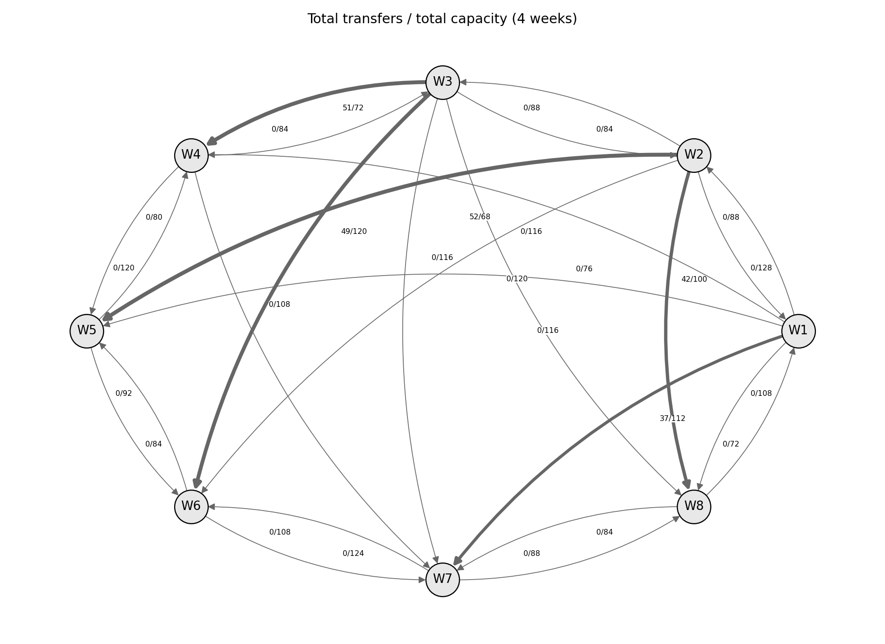

# Лабораторная работа № 2 — Балансировка запасов между складами

**Дисциплина:** Методы оптимизации  
**Автор:** Мандрыка Арина Юрьевна, Б24-507  
**Вариант:** 16 · **Seed:** `10017` · **Год:** 2026

**Полученный оптимум:** 670,254 руб. Полный отказ наиболее загруженной дуги увеличивает стоимость до 722,002 руб.



## Задача

Распределить однотипный товар между **8 складами за 4 недели**, удовлетворяя недельный спрос, учитывая поступления, остатки, ёмкость хранения, направления и пропускную способность перевозок. Минимизируется сумма транспортных затрат и стоимости хранения.

**Метод:** непрерывная модель минимальной стоимости потока в пространственно-временной сети, HiGHS (двойственный симплекс). Для визуализации используется NetworkX, но оптимизация выполняется именно как **LP**.

## Установка и запуск

Python 3.12+; из корня проекта:

```bash
python -m pip install -r requirements.txt
python main.py
python -m unittest discover -s tests -v
```

Повторная генерация данных с тем же seed:

```bash
python generate.py
python main.py
```

## Исследуемые сценарии

| Сценарий | Условия |
| --- | --- |
| `base` | Базовый поток |
| `congestion` | Пропускная способность наиболее загруженного маршрута −50% |
| `closure` | Полный отказ наиболее загруженного маршрута |
| `demand_plus_20` | Спрос всех складов и недель +20% |
| `stress` | Рост спроса +20% и отказ маршрута |

На каждом узле каждой недели отдельно проверяется уравнение баланса запасов; на каждой дуге — ограничение пропускной способности. Дополнительно записываются теневые цены и насыщенные дуги, а также результат жадного алгоритма поиска дешёвых доступных путей.

## Файлы

| Файл / каталог | Содержание |
| --- | --- |
| `data/instance.json` | Сеть, складские запасы, спрос и поставки |
| `generate.py` | Генератор воспроизводимого экземпляра |
| `model.py` | Постановка LP и сценарии |
| `heuristic.py` | Жадное перераспределение по дешёвым путям |
| `verify.py` | Независимая проверка балансов, границ и стоимости |
| `main.py` | Эксперименты, CSV, протокол, графики |
| `tests/` | Тесты баланса, ограничений и сценариев |
| `results/` | Таблицы, проверки и графические результаты |
| `report.pdf`, `report.docx` | Отчёт по работе |

Ключевые результаты: `results/flows_base.csv`, `results/inventory_base.csv`, `results/dual_capacity.csv`, `results/scenarios.csv`, `results/warehouse_network.png`, `results/inventory_by_week.png`, `results/solver_log.txt`.

**Подписи на схеме сети:** суммарный поток / суммарная пропускная способность за четыре недели. Остаток на конец недели не может быть отрицательным; неотгруженная продукция сохраняется на складе.
